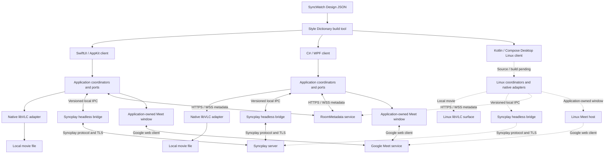
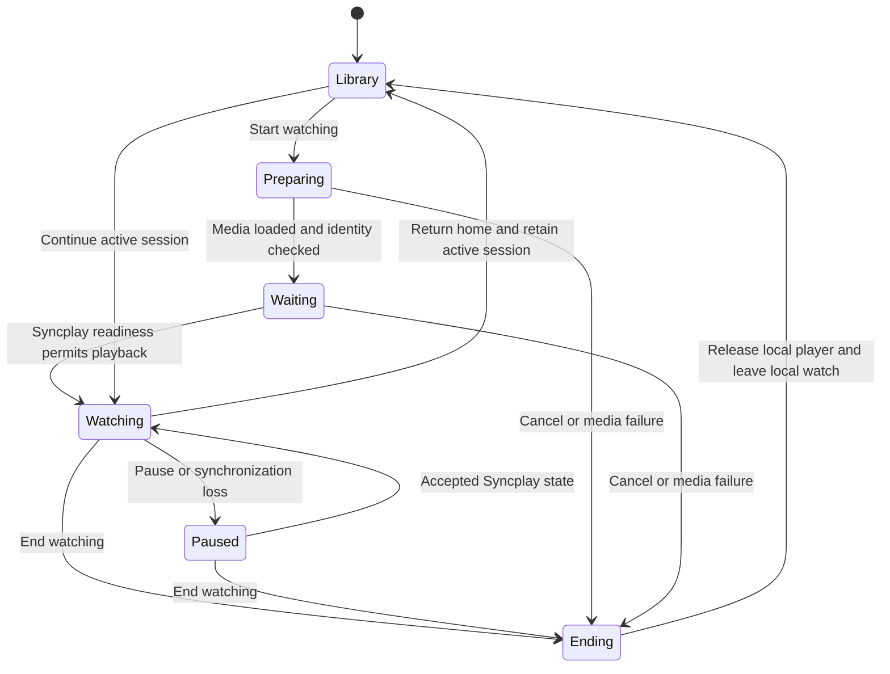

# Application architecture

SyncWatch is a native desktop product for synchronized local movie viewing and video calls. Swift/macOS, C#/WPF on Windows and Kotlin/Compose on Linux implement local Library/WatchSession ownership, preferences, resume persistence and native VLC playback. The shared declarative design library supplies their Library, settings, player, Room and call surfaces. Native clients support room create/join/leave and passive presence independently of playback. Normal same-file admission attaches an owned Syncplay helper to each native player, with descriptor hashing bound to its loaded input. Missing or ambiguous edition recovery, canonical installation, reconnect and Google Meet host integration remain incomplete.

## Technology decisions

| Area | Decision |
|---|---|
| Product platforms | macOS, Windows 11 x64, and Linux x64 |
| macOS client | Swift, SwiftUI, and AppKit for video surfaces and window management |
| Linux client | Kotlin/JVM with Compose Multiplatform Desktop; source/license closure precedes the application build |
| Windows client | C#, WPF, and .NET 10 LTS, with a small libVLC P/Invoke adapter |
| Shared design | Platform-neutral JSON tokens and component contracts in `packages/design`; Apache 2.0 Style Dictionary generates native resources |
| Playback | Embedded libVLC with SyncWatch controls |
| Synchronization | The upstream Syncplay client engine in a headless helper on each device, connected to a standard Syncplay server |
| Calling | Google Meet in a separate application-owned window; browser-host integration is not implemented |
| Room metadata | A C# / ASP.NET Core service over HTTPS/WSS for catalog and watch-session metadata |
| External libraries | Pinned source submodules under `3rdparty/`, including the complete transitive graph before component builds |
| Continuous integration | GitHub Actions for repository checks, native macOS/Windows builds, required Linux Kotlin-domain/JVM checks, reproducible dependencies, integration checks, and trusted release candidates |

The Windows SDK selection is pinned in [global.json](../../global.json) and the [toolchain manifest](../../tools/native/toolchains.json). See the [.NET support policy](https://dotnet.microsoft.com/en-us/platform/support/policy/dotnet-core). Additional Apple platforms require explicit decisions about process hosting, video surfaces, and call windows; macOS support does not imply iOS or tvOS support.

## Component topology



Each device reads its own movie file. Only play, pause, seek, and movie/playlist-item selection are shared user playback actions. RoomMetadata supplies the identities, ordering, membership, and authorization needed for them. Other application preferences and presentation state remain local. Google Meet handles calling independently; ending a call does not disconnect playback synchronization.

## State ownership

| Module or port | Responsibility and source of truth |
|---|---|
| LibraryService | Local catalog, authorized folder access, filesystem watching, and metadata cache; full paths stay local |
| MediaIdentity | Candidate matching, collision handling, and edition verification |
| WatchSessionCoordinator | Active media, generation, start/continue/end lifecycle, and application navigation |
| PlaybackPort | Media loading, pause, seek, rate, tracks, and local volume; actual VLC state is authoritative for observations |
| SyncPort | Syncplay connection, participants/readiness, allowed play/pause/seek actions, and local drift correction |
| RoomPort | Catalog exchange, media selection, session generations, missing media, Meet URI, and cross-channel participant binding |
| PreviewService | Separate bounded preview decoder and cache with cancellation; never changes the main player |
| CallPort | Call participation, first-join camera state, local preview, isolated output, shutdown, and verified capabilities; page load does not imply participation |
| SettingsService | Versioned local preferences, theme, language, playback settings, and schema upgrades |
| ConnectionSupervisor | Independent recovery of playback synchronization, metadata, and call channels |
| Design renderer | Displays state and emits user actions; contains no networking or media engine logic |

Swift, C# and Kotlin implement the [shared contracts](contracts.md) and consume the same acceptance fixtures, including local watch generations and preference persistence. Domain behavior remains independent of UI and provider SDK types. The Python helper adapts the selected Syncplay engine while each application uses its selected desktop stack.

## Native video integration

Compile, test and run each desktop client only on its target OS: Swift on macOS,
C# on Windows, and Kotlin on Linux. This includes client domain and UI consumer
checks. Shared contract fixtures run through each native implementation on its
own OS; interoperability uses those three actual clients in all six directions.

On macOS, pass an AppKit `NSView` to `libvlc_media_player_set_nsobject`. Keep the view alive until rendering stops. Use an AppKit container and native window manager with SwiftUI controls. Validate compositing, clipping, fullscreen transitions, and hardware decoding.

On Windows, pass a native HWND to `libvlc_media_player_set_hwnd`. WPF controls cannot simply overlap another HWND because of airspace restrictions. The planned video host uses an owned overlay window for player controls and popovers, with coordinated position, DPI, focus, minimize, and fullscreen behavior. Validate this before implementing the full player UI. CPU-copy video callbacks require performance measurements before adoption for 4K playback. See [WPF technology regions](https://learn.microsoft.com/en-us/dotnet/desktop/wpf/advanced/technology-regions-overview).

VLC image-adjustment APIs cover part of the image settings. Subtitle typography, external audio, audio normalization, and scaling still need working mappings for the selected module set. Some settings may require media reconfiguration. Every enabled control must have a verified effect. C API headers are in `3rdparty/vlc/include/vlc/`.

## Watch lifecycle



The watch and call lifecycles are separate. Returning home retains the active watch session. End releases local resources without an extra remote stop/close command. Membership bookkeeping must not become a fifth synchronized user action. Call audio is silent outside an active joined call and stops after hangup, close, or failed join. A new application launch may restore the last position, but it does not reactivate the previous session automatically.

Synchronization loss pauses playback and resets the rate to 1.0. Commands from an old generation are rejected. A call-only failure does not pause the movie. Metadata-only failure retains the agreed media but blocks operations that require a new shared selection.

## Source layout

Native shells, local domain modules, the room metadata service, the design package, documentation, contracts, validation tooling, workflows, and pinned submodules exist. Media/provider services and full product workflows in the layout below remain planned:

```text
apps/macos/                 # Swift application and native platform adapters
apps/windows/               # C# WPF application and native platform adapters
apps/linux/                 # Kotlin/Compose application and native platform adapters
packages/design/            # Platform-neutral design data and component contracts
packages/macos-domain/      # Swift domain and use cases, independent of SwiftUI
packages/windows-domain/    # C# domain and use cases, independent of WPF
packages/linux-domain/      # Kotlin domain and atomic local persistence
contracts/                  # JSON schemas and shared acceptance fixtures
services/syncplay-bridge/   # Headless Python entry point and player/UI adapters
services/room-metadata/     # C# ASP.NET Core metadata service
tools/design/              # Custom Style Dictionary formatters
tools/dependencies/        # Source graph and deterministic build tooling
tools/ci/                  # Shared local/CI validation and orchestration
tools/contracts/           # Offline reference contract validation and tests
tools/native/              # Native SDK, formatting, build, and test entry points
tools/server/              # Server SDK provisioning, builds, transport and wire checks
.github/workflows/         # Repository, platform, dependency, integration, and release jobs
tests/                      # Planned integration coverage
3rdparty/                   # External source Git submodules
docs/                       # Application documentation and architecture
```

Dependencies point from UI to application to domain. Filesystem, VLC, Syncplay, and Meet integrations implement domain-facing ports. The design package does not import application services or domain logic.

## Linux client

The Linux client is implemented in Kotlin/JVM source with [Compose Multiplatform Desktop](https://github.com/JetBrains/compose-multiplatform#desktop). It runs on the JVM and uses Compose for its desktop UI. The existing JSON design source and wire contracts remain shared; macOS keeps SwiftUI/AppKit and Windows keeps C#/WPF.

Compose's JetBrains-owned code uses [Apache 2.0](https://github.com/JetBrains/compose-multiplatform/blob/master/license/README.md). The selected source profiles record pinned Compose/AndroidX, Kotlin runtime, renderer and declared native/font inputs with their notices. Extending that graph requires reviewing the new transitive and embedded code and bundled fonts. Compiler, JDK and build-tool versions remain separately declared; a packaged Java runtime needs its own source, notice and distribution review. Neither a toolchain exception nor Compose's top-level license clears additional artifacts. See [dependency policy](dependencies.md) and [licenses and distribution](../licenses.md).

Linux has a compiled Kotlin domain, source-built desktop graph, native X11 VLC surface, owned Syncplay transport and Room application controller. Native local lifecycle, scoped loaded-content hashing, room membership and controlled cross-platform playback are exercised together with macOS and Windows. Complete normal room/media admission, canonical distribution and Meet hosting remain open. X11 and Wayland require separate rendering, fullscreen, input, DPI, capture and window-ownership qualification, including any XWayland dependency. Google Meet remains the call provider. Compose does not select or verify a browser host; any candidate needs its own complete source/license graph and real Meet capability checks before adoption.

## Local data and permissions

Store versioned state under Application Support on macOS, LocalAppData on Windows and the absolute XDG_STATE_HOME location on Linux, with its standard per-user fallback. Use atomic writes and application-owned cache locations. Room credentials currently remain in memory; any future persistence must use protected storage on each target OS. Use an application-specific browser profile. Balance macOS security-scoped access for the lifetime of each media or folder operation.

Shared design assets contain no account, device, or room data. Catalog exchange sends only permitted media descriptors. A missing file does not trigger an upload. Audio controls affect only the intended movie or verified call output; system communications policy and other applications' volume remain outside the product's control.

## Integration limitations

| Component | Current limitation |
|---|---|
| Google Meet | Browser hosts, account access, media, native call controls, and capture shutdown are not implemented |
| VLC | Native surfaces, local lifecycle, scoped input ownership and controlled shared playback work on macOS, Windows and Linux; timeline previews, remaining overlays and complete player preferences are incomplete |
| Dependencies | Selected engine/runtime and desktop source profiles build and verify on their native targets; browser source closure, authenticated installation and canonical application distribution remain open |
| Syncplay bridge | Normal room/catalog/media admission connects native players on all3; complete desktop qualification, reconnect and authenticated installation remain open |
| Shared design | All3 clients consume common component, palette, typography and layout resources; native appearance preferences persist locally. Complete workflow parity, call behavior and remaining player overlays are incomplete |
| Linux client | Kotlin/Compose application, native X11 video, local lifecycle, loaded-content hashing, Room membership and normal shared admission are implemented; complete desktop qualification, canonical packaging, Wayland qualification and calling remain open |

These limitations distinguish the application architecture from the functionality available in the current shells.

## Related specifications

- [Application behavior](../application.md).
- [Building and running](../building.md).
- [Shared design system](design-system.md).
- [Shared contracts](contracts.md).
- [Local watch state and persistence](local-state.md).
- [Syncplay and room metadata](syncplay.md).
- [Room service API and ownership](room-service.md).
- [Google Meet integration](google-meet.md).
- [External dependencies](dependencies.md).

[Platform parity](platform-parity.md) defines the required three-client completion gate and current implementation matrix.
