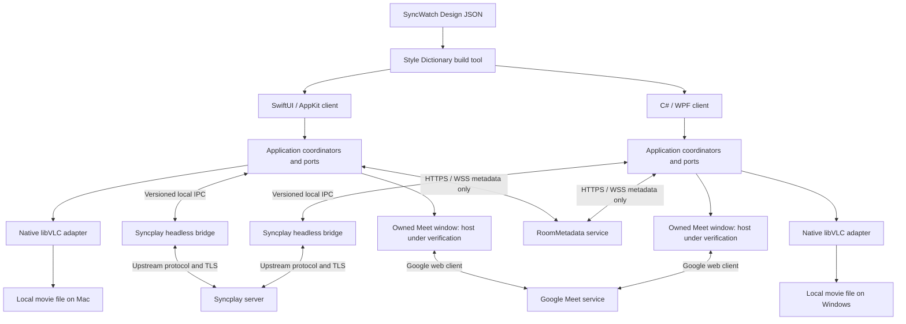
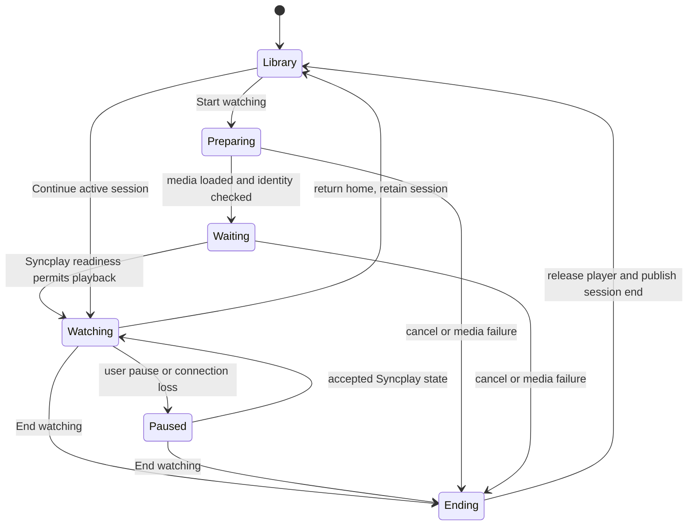

# Архитектура SyncWatch

Статус: проектирование от 17 октября 2026 года, после аудита прототипа и уточнений пользователя. Новые приложения ещё не реализованы. Базовые решения зафиксированы; перенос всех функций зависит от технических проверок Google Meet и libVLC.

## Зафиксированные решения

| Область | Решение |
|---|---|
| Первая поставка | Два desktop клиента: macOS на локальном Mac и Windows 11 x64 на `win-dev` |
| Apple | Swift, SwiftUI, AppKit для видео и управления окнами |
| Windows | C#, WPF, .NET 10 LTS; небольшой собственный P/Invoke слой к libVLC |
| Общий дизайн | Отдельный `packages/design`: platform-neutral JSON tokens + component contracts; Style Dictionary под Apache 2.0 генерирует ресурсы SwiftUI и WPF |
| Видео | Встроенный libVLC, собственные элементы управления в дизайне прототипа |
| Синхронизация | Настоящий upstream Syncplay engine в headless helper process, один и тот же на двух ОС; штатный Syncplay server |
| Звонок | Google Meet в отдельном принадлежащем приложению окне; web-host и media capabilities должны пройти feasibility gate |
| Прочие данные комнаты | Небольшой собственный RoomMetadata service: C# / ASP.NET Core, HTTPS/WSS; без movie media relay |
| Внешние исходники | Только закреплённые submodules в `3rdparty/`; полный транзитивный graph проверяется до сборки компонента |

Выбор .NET 10 основан на текущем LTS lifecycle; точный SDK закрепляется при первой реализации, после проверки browser binding. [Официальная поддержка .NET](https://dotnet.microsoft.com/en-us/platform/support/policy/dotnet-core).

Слово Apple сейчас означает macOS: пользователь указал локальный Mac. SwiftUI/domain/design можно переиспользовать, но iOS/tvOS не получают автоматического обещания поддержки. Desktop helper process и libVLC surface требуют отдельного решения на этих платформах.

## Схема компонентов



Фильм читается на каждом устройстве локально. Сервер синхронизации передаёт playback state, RoomMetadata передаёт описания и session metadata, Google обслуживает звонок. Выключение камеры или закрытие звонка не выключает синхронизацию фильма.

## Границы и владение состоянием

| Модуль / порт | Ответственность и источник истины |
|---|---|
| LibraryService | Локальный каталог, picker grants, watcher, metadata cache. Полные пути остаются локально |
| MediaIdentity | Перенос prototype movieId, проверка совпадений/коллизий и редакций; отсутствие файла не маскируется |
| WatchSessionCoordinator | Единственный владелец lifecycle просмотра: выбранное медиа, generation, start/continue/end, UI navigation |
| PlaybackPort | Load, pause, seek, rate, tracks, local volume; события фактического состояния VLC, а не желаемого положения слайдера |
| SyncPort | Syncplay соединение, список участников, readiness, authoritative shared playback и коррекция рассинхронизации |
| RoomPort | Каталоги, media selection/session generations, missing media, Meet URI, привязка участников между каналами |
| PreviewService | Отдельный ограниченный decoder/cache, cancellation и очистка; не меняет основной player |
| CallPort | Состояние web-window и подтверждённые capabilities. Page loaded не означает joined; состояние микрофона нельзя выдумывать |
| SettingsService | Версионированные local preferences, тема/язык, playback preferences, миграция с проверкой схемы |
| ConnectionSupervisor | Различает playback sync, room metadata и call failures; восстанавливает каналы независимо |
| Design renderer | Показывает snapshot и отправляет user intent; не содержит network, VLC или Syncplay logic |

Swift и C# реализуют одинаковые контракты, но не пытаются напрямую использовать один UI binary. Общие JSON contracts и одинаковые acceptance vectors предупреждают расхождение поведения. Python helper — адаптер к выбранному Syncplay, а не замена Swift/C# приложения.

## Нативные видео и окна

На macOS libVLC получает `NSView` через `libvlc_media_player_set_nsobject`; view живёт до остановки renderer. SwiftUI использует AppKit container и нативный window manager. Нужно проверить overlay, clipping, fullscreen и hardware decode на локальном Mac.

На Windows libVLC получает HWND через `libvlc_media_player_set_hwnd`. WPF controls нельзя просто нарисовать поверх чужого HWND: действует ограничение airspace. План — собственный video host и отдельное owned overlay window для player chrome/popovers; они управляются как одно окно по позиции, DPI, focus, minimize и fullscreen. Это обязательный эксперимент до переноса всего UI. CPU-copy video callbacks не назначаются основным 4K renderer без измерений. [Microsoft: WPF technology regions](https://learn.microsoft.com/en-us/dotnet/desktop/wpf/advanced/technology-regions-overview).

`libvlc_video_set_adjust_*` покрывает часть image controls. Настройка шрифта/обводки/позиции subtitles, external audio, normalize audio и smooth scaling требует проверки выбранных модулей/пересоздания media при необходимости. Визуальная галочка без работающего VLC mapping не считается реализацией. Заголовки API доступны в `3rdparty/vlc/include/vlc/`.

## Lifecycle



Watch lifecycle и call lifecycle — разные автоматы. Возврат домой сохраняет активный просмотр; End завершает его. Новый запуск приложения может восстановить last position, но не объявляет старую session активной. На разрыв Syncplay основной player ставится на паузу, rate сбрасывается в 1.0, старые команды после смены generation отбрасываются. Разрыв только Meet не останавливает фильм.

## Планируемое дерево исходников

Только `docs/`, `packages/design/` и три submodules уже существуют. Остальные пути ниже — план, не готовые проекты:

```text
apps/apple/                 # Swift app composition, SwiftUI/AppKit, platform adapters
apps/windows/               # C# WPF app composition and platform adapters
packages/design/            # общий дизайн без привязки к UI framework
packages/apple-domain/      # Swift domain/use cases, без SwiftUI
packages/windows-domain/    # C# domain/use cases, без WPF
contracts/                  # JSON schemas + platform-independent acceptance fixtures
services/syncplay-bridge/   # Python entrypoint, custom BasePlayer/UI adapters
services/room-metadata/     # C# ASP.NET Core server, metadata only
tools/design/               # собственные Style Dictionary formatters
tools/dependencies/         # graph/source audit and deterministic build tooling
tests/                      # cross-platform contract/integration fixtures
3rdparty/                   # все внешние source submodules
docs/                       # все документы, включая инструкции и проверки
```

Бизнес-логика следует направлению `UI → application → domain`; VLC, Syncplay, filesystem и Meet находятся за ports. Модуль design не импортирует services/domain, renderer не зависит от provider-specific SDK types.

## Хранение и приватные данные

Preferences/cache находятся в Application Support на macOS и LocalAppData на Windows, с `schemaVersion` и атомарной записью. OAuth tokens — Keychain/Windows protected storage. Browser profile — отдельный app profile, не импорт чужих browser cookies. macOS bookmarks открываются на время чтения и освобождаются владельцем media/grant.

Room session tokens, Meet URLs и device addresses не включаются в Git, diagnostics или общий design package. В сеть каталога отправляются только согласованные media descriptors; отсутствие общего файла не запускает upload. Громкость меняется только у movie player и подтверждённого call output; глобальную communications policy/громкость других приложений не менять.

## Решения, которые ещё требуют доказательств

| Gate | Что нельзя считать завершённым |
|---|---|
| G1: Google Meet | Работающее owned in-app call window на обеих ОС, вход, camera/mic, hangup и требуемые capabilities; публичный SDK их не гарантирует |
| G2: Native VLC parity | Overlay на Windows, preview и все настройки player/subtitles/audio; измерения 4K с одновременным звонком |
| G3: Dependency closure | Все транзитивные исходники в submodules, воспроизводимая сборка и notices |
| G4: Syncplay bridge | Headless imports/config, IPC lifecycle, upstream compatibility и reconnect на двух устройствах |
| G5: Visual parity | Полный baseline и screenshots обоих native клиентов; tokens сами по себе не являются доказательством |

Закрытая недокументированная интеграция Meet не подменяется молча внешним браузером или LiveKit. Если G1 не проходит, потребуется конкретное продуктовое решение пользователя; остальные модули остаются пригодны для разработки.

## Подробности

- [Аудит функций прототипа](prototype-baseline.md).
- [Общая библиотека дизайна](design-system.md).
- [Syncplay, IPC и метаданные комнаты](syncplay.md).
- [Google Meet и границы интеграции](google-meet.md).
- [Исходники зависимостей и незавершённый graph](dependencies.md).
- [План реализации и проверок](delivery-plan.md).
- [Что фактически проверено](verification.md).
