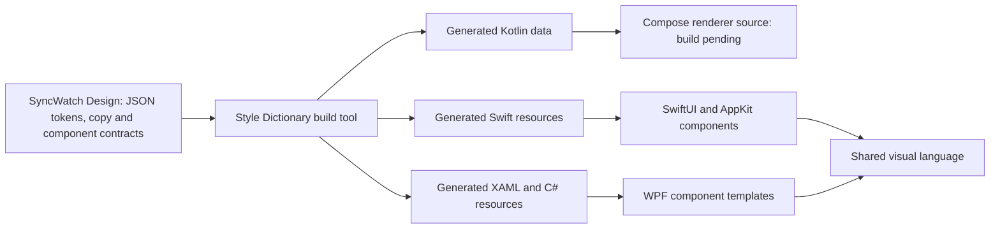

# Shared design system

`packages/design` is the platform-neutral SyncWatch Design library, licensed under Apache 2.0. It defines visual values and component contracts independently of a UI framework. Style Dictionary, also Apache 2.0, generates resources for the Swift, C# and Kotlin clients at build time.

## Package structure

| File | Responsibility |
|---|---|
| `packages/design/tokens/palette.json` | Shared accent colors and dark/light color values |
| `packages/design/tokens/geometry.json` | Screen dimensions, spacing, and control geometry |
| `packages/design/themes.json` | Semantic dark/light color roles and logical units |
| `packages/design/generated/` | Generated SwiftUI, C#, XAML, Kotlin and shared manifest |
| `packages/design/copy.json` | English/Russian copy and Library gallery fixtures |
| `packages/design/apple/`, `windows/`, `linux/` | Native Library presentation and reusable components |
| `packages/design/components.json` | Library, player, settings, and call window structures, states, and actions |
| `packages/design/package.json` | Design package identity, version, license, and packaged assets |

Tokens use the Style Dictionary `type`/`value` JSON format. Colors are sRGB hex values. Dimensions are logical numeric values mapped to points on macOS and density-independent units on Windows/Compose. Physical display scale is handled by the renderer rather than embedded in token values.

The package contains design data, component specifications and the Library renderer. A [source-only native Node profile](../design-generator.md) runs Style Dictionary with pinned transitive sources, explicit package resolution, and custom formatter support. Dedicated SwiftUI/WPF/Kotlin formatters generate committed resources. The macOS and Windows shells render an empty Library workspace. An opt-in gallery exercises presentation fixtures. The Compose Library renderer is source-only until its complete dependency build is available. Player, settings and call components remain specifications.

## Generated resources

Dedicated native formatters consume the declared source profile. See [generation commands and resource APIs](../design-generator.md#native-resource-generation):

| Output | Contract |
|---|---|
| `SyncWatchTokens.swift` | SwiftUI colors, dimensions, and theme roles; usable on macOS without an unconditional UIKit import |
| `SyncWatchTokens.g.cs` | Typed C# values with matching token IDs |
| `SyncWatchTheme.g.xaml` | WPF Color, SolidColorBrush, Double, Thickness, and CornerRadius resources |
| `SyncWatchTokens.kt` | Dependency-free Kotlin sRGB RRGGBBAA values, logical dimensions, themes, copy and gallery data |
| `design-manifest.json` | Design schema version, design source digest, copy, and generator revision shared by all clients |

Generation must be deterministic: stable ordering and rounding, with no build-time timestamp in the output. Unknown types and unresolved references are build errors. Generated resources are consumed by the native clients and are not edited manually.

Style Dictionary provides Swift formats, but framework-specific SwiftUI/macOS and WPF output needs dedicated formatting. See the [format reference](https://styledictionary.com/reference/hooks/formats/predefined/).

The Kotlin formatter runs in the same generation command. The Compose source uses Foundation primitives, explicitly maps RRGGBBAA channels to Compose colors, and reads the same token IDs, copy, states and actions. No Compose or compiler binary is adopted by adding this first-party source. The Linux application remains unavailable until its pinned source/native/compiler/license closure and real build pass.

## Component implementation

Tokens define values. Component contracts define structure, semantic roles, interaction states, focus behavior, and actions. Native renderers implement these contracts; Style Dictionary does not render controls or implement their behavior.

The visual language includes a two-column library, deep blue surfaces and gradients, compact controls and menus, player overlays, settings sidebars, and consistent status indicators. Theme roles select dark or light resources; system mode follows the current operating-system appearance.

Library typography uses the shared 12/14/19/23/31 logical size hierarchy with native system fonts. The brand play mark uses the same first-party normalized triangle on every renderer. A future external icon/font source must be pinned under `3rdparty/` and reviewed before adoption. Native font metrics remain part of visual acceptance.

## Rendering boundaries

Shared states include library empty/searching/scanning/selected/disconnected modes, player loading/playing/paused/fullscreen/preview/menu modes, settings dialogs, and the call window. Themes and localization affect layout as well as colors and text.

Native renderers own font metrics, focus, keyboard input, display scaling, and overlays. On Windows, video-overlay hit testing and z-order depend on the HWND integration. Matching token values alone does not produce identical native rendering.

## Library component and gallery

`LibraryPresentation` supplies entries, selected identity, visual state and enabled action IDs. `LibraryWorkspace` renders that data and emits an action callback. It imports no filesystem, playback, synchronization, metadata or call services. The normal shell has no service capabilities enabled. Selecting a gallery row or typing a query only changes fixture presentation or emits a gallery callback; it does not start playback or call a provider.

All renderers cover `empty`, `scanning`, `selected`, `missingMedia` and `reconnecting`. Start requires an existing selection in the selected state; stale row identities and unknown/unavailable actions are rejected. The shared library width is 360, header height 64, workspace inset 18, panel gap 14 and radius 16. Selected details adapt between 260 and 375 logical units with scrolling. The minimum content viewport is 800 by 600; the reference gallery viewport is 1120 by 760. Long titles, translated labels and watch actions must remain usable at the minimum viewport.

Use `--design-gallery` when launching the native executable; see [building](../building.md). The gallery switches state, English/Russian copy and dark/light themes. It is a development view with synthetic movie names. System appearance remains the normal shell default. Library filtering is local presentation behavior; catalog scanning and watch-session workflows require their application adapters.

Native checks exercise action rejection, stale identities, theme resources, localized copy, and 40 actual renders per platform (five states, two themes, two languages, two viewports). macOS uses an unshown NSHostingView window so AppKit text/scroll controls are included without exposing the desktop; Windows uses WPF RenderTargetBitmap. PNGs under `artifacts/design/<platform>/` are retained with hashes in the native CI artifact. These checks establish component evidence, not full product or Linux visual acceptance.
