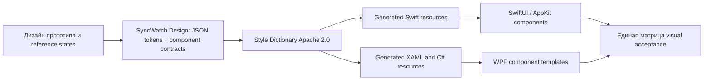

# Общая библиотека дизайна

Решение: `packages/design` — отдельная библиотека данных SyncWatch Design под Apache 2.0. Она описывает внешний вид и контракт компонентов независимо от ОС. `3rdparty/style-dictionary` под Apache 2.0 — инструмент преобразования описаний в ресурсы платформ. Swift и C# не содержат независимых копий палитры и размеров.

Такое разделение следует уточнению пользователя: нужна библиотека описания нашего общего дизайна, сохраняющая прототип, а не новая готовая тема.

## Что уже создано

- `packages/design/tokens/palette.json`: точные theme constants и дополнительные цвета экранов.
- `packages/design/tokens/geometry.json`: исследованная геометрия основных экранов и контролов.
- `packages/design/components.json`: состав, состояния и действия Library, PlayerChrome, Settings, PlayerSettings, CallWindowShell.
- `packages/design/provenance.json`: исходный commit и SHA-256 исследованных файлов.
- `packages/design/package.json`: manifest отдельной приватной библиотеки данных, Apache 2.0.

Формат токенов — поддерживаемый Style Dictionary JSON `type`/`value`; это не заявление о полной реализации DTCG 2025. Цвета — sRGB hex. Размеры — числа в logical units; каждый formatter переводит их в тип платформы без умножения на physical DPI.

Это начальная спецификация, не полный набор готовых компонентов. Генератор, Swift package и WPF assembly пока не реализованы. Все инструкции остаются в `docs/`, рядом с исходниками библиотеки дополнительные документы не создаются.

## Следующий исполняемый слой

После комплектации source dependencies генератора добавить собственные Style Dictionary formatters:

| Output | Контракт |
|---|---|
| `SyncWatchTokens.swift` | `Color` из SwiftUI, числовые размеры и theme roles; подходит macOS, без безусловного UIKit import |
| `SyncWatchTokens.g.cs` | Типизированные значения для C#, одинаковые token IDs |
| `SyncWatchTheme.g.xaml` | WPF ResourceDictionary: Color, SolidColorBrush, Double, Thickness, CornerRadius |
| `design-manifest.json` | Token schema version, source SHA и generator commit; одинаков для обеих платформ |

Генерация детерминированная: стабильная сортировка и одинаковое округление, без даты сборки в output. Unknown types и неразрешённые references — ошибка. Нативные outputs получают только из общей библиотеки, вручную их не исправляют.

У Style Dictionary есть Swift formats, но встроенный UIKit output не является автоматически рабочим SwiftUI/macOS output. Для WPF также нужен собственный formatter. [Первичный справочник formats](https://styledictionary.com/reference/hooks/formats/predefined/).

## Что задаёт общий дизайн

Tokens описывают значения. Component contracts описывают структуру, семантику, состояния, фокус, действия и layout. Платформенные renderers отвечают за реализацию этих контрактов; сама Style Dictionary не создаёт UI и не обеспечивает одинаковое поведение контролов.

Сохраняем двухколоночную библиотеку, тёмный синий gradient, размеры карточек/полей, компактные menus, player overlay, навигацию настроек и строки RU/EN. Тёмная/светлая темы выбирают semantic roles. `system` следует текущей теме ОС.

Типографика, иконки, все component states и адаптация к узкому окну ещё требуют полного visual baseline. Системные шрифты нельзя считать одинаковыми по метрикам. Для одинаковых иконок выбрать один набор с проверенной лицензией и добавить его исходники submodule; случайная замена SF Symbols на Segoe glyphs не считается сохранением дизайна.

## Критерии сохранения

Снять Library, empty/search/loading, selected media, player playing/paused/fullscreen/preview/context menu, оба Settings и call shell в dark/light, RU/EN. Размер viewport фиксируется в logical units, отдельно фиксируются scale factor и font metrics.

Проверять геометрию, порядок элементов, цвета и состояния; маскировать содержимое фильма/Meet и системные chrome области. Числовые tokens должны совпадать точно. Допуск raster differences шрифтов задаётся после эталонных снимков и ручного просмотра, а не объявляется заранее процентом.

При Windows video HWND отдельно проверить overlay hit testing и z-order. При обоих UI — tab order, focus, клавиши, multiline/long filenames и русский текст. Без снимков новых нативных экранов visual parity остаётся непроверенной.
