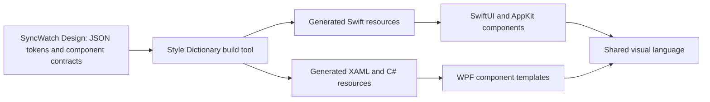

# Shared design system

`packages/design` is the platform-neutral SyncWatch Design library, licensed under Apache 2.0. It defines visual values and component contracts independently of a UI framework. Style Dictionary, also Apache 2.0, generates resources for the native Swift and C# clients at build time.

## Package structure

| File | Responsibility |
|---|---|
| `packages/design/tokens/palette.json` | Shared accent colors and dark/light color values |
| `packages/design/tokens/geometry.json` | Screen dimensions, spacing, and control geometry |
| `packages/design/themes.json` | Semantic dark/light color roles and logical units |
| `packages/design/generated/` | Generated SwiftUI, C#, XAML, and shared manifest |
| `packages/design/components.json` | Library, player, settings, and call window structures, states, and actions |
| `packages/design/package.json` | Design package identity, version, license, and packaged assets |

Tokens use the Style Dictionary `type`/`value` JSON format. Colors are sRGB hex values. Dimensions are logical numeric values mapped to points on macOS and DIP on Windows. Physical display scale is handled by the renderer rather than embedded in token values.

The current package contains design data and component specifications. A [source-only native Node profile](../design-generator.md) runs Style Dictionary with pinned transitive sources, explicit package resolution, and custom formatter support. Dedicated SwiftUI/WPF formatters generate committed resources consumed by both shells. Native component renderers still require implementation.

## Generated resources

Dedicated native formatters consume the declared source profile. See [generation commands and resource APIs](../design-generator.md#native-resource-generation):

| Output | Contract |
|---|---|
| `SyncWatchTokens.swift` | SwiftUI colors, dimensions, and theme roles; usable on macOS without an unconditional UIKit import |
| `SyncWatchTokens.g.cs` | Typed C# values with matching token IDs |
| `SyncWatchTheme.g.xaml` | WPF Color, SolidColorBrush, Double, Thickness, and CornerRadius resources |
| `design-manifest.json` | Design schema version, design source digest, and generator revision shared by both clients |

Generation must be deterministic: stable ordering and rounding, with no build-time timestamp in the output. Unknown types and unresolved references are build errors. Generated resources are consumed by the native clients and are not edited manually.

Style Dictionary provides Swift formats, but framework-specific SwiftUI/macOS and WPF output needs dedicated formatting. See the [format reference](https://styledictionary.com/reference/hooks/formats/predefined/).

A planned Linux client uses Kotlin/JVM and Compose Multiplatform Desktop. Its formatter and renderer will consume the same token IDs, logical units, theme roles, and manifest contract, mapping colors to Compose Color and dimensions to density-independent units. Kotlin/Compose output is not generated by the current Swift/WPF command.

## Component implementation

Tokens define values. Component contracts define structure, semantic roles, interaction states, focus behavior, and actions. Native renderers implement these contracts; Style Dictionary does not render controls or implement their behavior.

The visual language includes a two-column library, deep blue surfaces and gradients, compact controls and menus, player overlays, settings sidebars, and consistent status indicators. Theme roles select dark or light resources; system mode follows the current operating-system appearance.

Typography, icons, and responsive layouts must receive explicit cross-platform specifications. Use a consistent icon source with its source pinned under `3rdparty/`. System font metrics and platform icon fonts are not interchangeable visual specifications.

## Rendering boundaries

Shared states include library empty/searching/scanning/selected/disconnected modes, player loading/playing/paused/fullscreen/preview/menu modes, settings dialogs, and the call window. Themes and localization affect layout as well as colors and text.

Native renderers own font metrics, focus, keyboard input, display scaling, and overlays. On Windows, video-overlay hit testing and z-order depend on the HWND integration. Matching token values alone does not produce identical native rendering.
