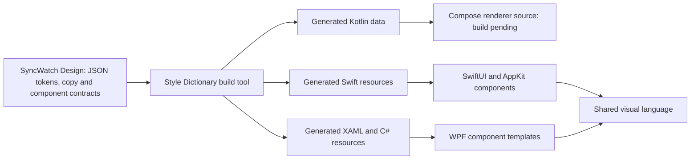

# Shared design system

`packages/design` is the platform-neutral SyncWatch Design library, licensed under Apache 2.0. It defines visual values and component contracts independently of a UI framework. Style Dictionary, also Apache 2.0, generates resources for the Swift, C# and Kotlin clients at build time.

## Package structure

| File | Responsibility |
|---|---|
| `packages/design/tokens/palette.json` | Shared accent colors and dark/light color values |
| `packages/design/tokens/geometry.json` | Screen dimensions, spacing, and control geometry |
| `packages/design/themes.json` | Semantic dark/light color roles and logical units |
| `packages/design/generated/` | Generated SwiftUI, C#, XAML, Kotlin and shared manifest |
| `packages/design/copy.json` | English/Russian copy and Library gallery fixtures |
| `packages/design/player.json` | Player states/actions and first-party normalized icons |
| `packages/design/call.json` | Call presentation states, preview states, action payload kinds, gallery cases and first-party icons |
| `packages/design/player-settings.json` | Player settings sections, fields, bounds, steps, choices, swatches, units and defaults |
| `packages/design/settings.json` | Settings sections, field IDs/kinds/options/defaults and validation bounds |
| `packages/design/apple/`, `windows/`, `linux/` | Native Library/Settings/Player presentation and reusable components |
| `packages/design/components.json` | Library, player, settings, and call window structures, states, and actions |
| `packages/design/package.json` | Design package identity, version, license, and packaged assets |

Tokens use the Style Dictionary `type`/`value` JSON format. Colors are sRGB hex values. Dimensions are logical numeric values mapped to points on macOS and density-independent units on Windows/Compose. Physical display scale is handled by the renderer rather than embedded in token values.

The package contains design data, component specifications and the Library, Settings, PlayerChrome, PlayerSettingsDialog and CallWindowShell renderers. A [source-only native Node profile](../design-generator.md) runs Style Dictionary with pinned transitive sources, explicit package resolution, and custom formatter support. Dedicated SwiftUI/WPF/Kotlin formatters generate committed resources. The macOS and Windows shells render the Library workspace and an owned application-settings dialog. An opt-in gallery exercises presentation fixtures. Matching Compose renderers are source-only until their complete dependency build is available. Remaining player overlays and provider integration await implementation.

## Generated resources

Dedicated native formatters consume the declared source profile. See [generation commands and resource APIs](../design-generator.md#native-resource-generation):

| Output | Contract |
|---|---|
| `SyncWatchTokens.swift` | SwiftUI colors, dimensions, and theme roles; usable on macOS without an unconditional UIKit import |
| `SyncWatchTokens.g.cs` | Typed C# values with matching token IDs |
| `SyncWatchTheme.g.xaml` | WPF Color, SolidColorBrush, Double, Thickness, and CornerRadius resources |
| `SyncWatchTokens.kt` | Dependency-free Kotlin sRGB RRGGBBAA values, logical dimensions, themes, copy and gallery data |
| `design-manifest.json` | Design schema version, design source digest, copy, and generator revision shared by all clients |

Generation must be deterministic: stable ordering and rounding, with no build-time timestamp in the output. Unknown types and unresolved references are build errors. Generated resources are consumed by the native clients and are not edited manually.

Style Dictionary provides Swift formats, but framework-specific SwiftUI/macOS and WPF output needs dedicated formatting. See the [format reference](https://styledictionary.com/reference/hooks/formats/predefined/).

The Kotlin formatter runs in the same generation command. The Compose source uses Foundation primitives, explicitly maps RRGGBBAA channels to Compose colors, and reads the same token IDs, copy, states and actions. Settings metadata is also generated into all three languages. No Compose or compiler binary is adopted by adding this first-party source. The Linux application remains unavailable until its pinned source/native/compiler/license closure and real build pass.

## Component implementation

Tokens define values. Component contracts define structure, semantic roles, interaction states, focus behavior, and actions. Native renderers implement these contracts; Style Dictionary does not render controls or implement their behavior.

The visual language includes a two-column library, deep blue surfaces and gradients, compact controls and menus, player overlays, settings sidebars, and consistent status indicators. Theme roles select dark or light resources; system mode follows the current operating-system appearance.

Library typography uses the shared 12/14/19/23/31 logical size hierarchy with native system fonts. The brand play mark uses the same first-party normalized triangle on every renderer. A future external icon/font source must be pinned under `3rdparty/` and reviewed before adoption. Native font metrics remain part of visual acceptance.

## Rendering boundaries

Shared states include library empty/searching/scanning/selected/disconnected modes, player loading/playing/paused/fullscreen/preview/menu modes, settings dialogs, and the call window. Themes and localization affect layout as well as colors and text.

Native renderers own font metrics, focus, keyboard input, display scaling, and overlays. On Windows, video-overlay hit testing and z-order depend on the HWND integration. Matching token values alone does not produce identical native rendering.

## Library component and gallery

`LibraryPresentation` supplies entries, selected identity, visual state and enabled action IDs. `LibraryWorkspace` renders that data and emits an action callback. It imports no filesystem, playback, synchronization, metadata or call services. The normal shell has no service capabilities enabled. Selecting a gallery row or typing a query only changes fixture presentation or emits a gallery callback; it does not start playback or call a provider.

All renderers cover `empty`, `scanning`, `selected`, `missingMedia` and `reconnecting`. Start requires an existing selection in the selected state; stale row identities and unknown/unavailable actions are rejected. The shared library width is 360, header height 64, workspace inset 18, panel gap 14 and radius 16. Selected details adapt between 260 and 375 logical units with scrolling. The minimum content viewport is 800 by 600; the reference gallery viewport is 1120 by 760. Long titles, translated labels and watch actions must remain usable at the minimum viewport.

Use `--design-gallery` when launching the native executable; see [building](../building.md). The gallery switches state, English/Russian copy and dark/light themes. It is a development view with synthetic movie names. System appearance remains the normal shell default. Library filtering is local presentation behavior; catalog scanning and watch-session workflows require their application adapters.

Native checks exercise action rejection, stale identities, theme resources, localized copy, and 40 actual renders per platform (five states, two themes, two languages, two viewports). macOS uses an unshown NSHostingView window so AppKit text/scroll controls are included without exposing the desktop; Windows uses WPF RenderTargetBitmap. PNGs under `artifacts/design/<platform>/` are retained with hashes in the native CI artifact. These checks establish component evidence, not full product or Linux visual acceptance.

## Application settings

`settings.json` defines the interface/library/call/connection sections, typed fields, choices, defaults and UTF-16 length bounds. `SettingsEditor` holds a draft independently of application services. Unknown fields, unsupported choices, invalid booleans, control characters and oversized values cannot reach its save callback. Field capabilities reject edits to unavailable controls. Save feedback requires the caller to acknowledge persistence; a failed write keeps the draft and shows an error. Cancel returns to the last successful save without invoking persistence.

`SettingsDialog` uses the shared 680 by 420 content size and 150-unit sidebar. The same metadata drives compact fields, choices and switches in each renderer. The gallery supports editing/saved/error fixtures and an explicit save-failure switch. No fixture claims to persist real configuration or enumerate hardware.

In the macOS and Windows applications, Settings opens from the Library header. The application controller maps only theme/language into the existing validated LocalState, preserving every other preference, selected-media ID and resume position. Successful writes update language and dark/light/system appearance without restarting; reopening the application restores them. Write failure leaves the applied appearance unchanged. A future-version or unreadable state file makes editing unavailable rather than overwriting that file. Library access, call devices and connection fields stay disabled until their service adapters are implemented. A stored preference does not start playback or a call.

Native checks add 48 Settings images (four sections, three states, two themes and two languages) to the 40 Library images per platform. The native CI artifact requires the exact complete image-name set derived from the shared contracts and geometry, with bounded PNG payloads and hashes. Native control events, draft/save/cancel behavior, keyboard containment/default/cancel actions and actual appearance persistence are exercised separately from image generation. Full keyboard/provider/physical acceptance remains open. Compose renderer source remains excluded from available builds until Linux dependency/compiler/native/license closure passes.

## Core player chrome

`player.json` defines the supported presentation states/actions and first-party polygon icons in a normalized 20-unit coordinate system. The generator validates geometry and emits the same data into Swift/C#/Kotlin without a font or icon dependency. Shared tokens define toolbar/footer sizes, control hit targets and timeline geometry.

`PlayerPresentation` describes observations and capabilities only. Requests do not acknowledge or mutate observations. Unknown/unavailable actions, invalid positions/durations, nonfinite/out-of-range volume, fractional seek positions and invalid skip directions are rejected. Skip produces a bounded absolute seek; it never adds a shared playback-speed preference or a separate synchronized skip operation. Loading, buffering, interrupted and ended states reject playback controls. Invalid observations are safely clamped for display while retaining navigation capabilities.

SwiftUI/WPF `PlayerChrome` and matching Compose source render the compact toolbar, centralized transport, timeline, movie volume/mute and an owned video-content slot. Updating observations creates no user request. Normal application entry into playback awaits its media adapter; `--player-gallery` is an isolated fixture. The gallery gear opens the player-settings component; track/playlist controls remain unavailable, and window/call/navigation actions are callbacks rather than provider operations. Physical focus/keyboard/display-scale/video-overlay/fullscreen acceptance and complete media/provider integration remain open.

## Player settings

`player-settings.json` defines five sections and 21 fields independently of an operating system. Generated Swift/C#/Kotlin metadata includes field kinds, rows, localized labels, choices, color tokens, defaults, units and numeric bounds/steps. Numeric drafts use invariant decimal strings. All clients reject unsupported choices/booleans, unknown keys/capabilities, control characters, oversized values, nonfinite or nondecimal numbers, out-of-range values and values outside the declared step grid.

`PlayerSettingsEditor` owns a draft and the last acknowledged snapshot. Edits and section reset affect only fields with edit capabilities; reset never writes storage. Cancel restores the last acknowledged snapshot. Save validates the entire draft and publishes a copy to the caller. A false acknowledgement retains the draft, displays failure and leaves the saved snapshot unchanged. Read-only mode rejects edits, reset and save even if edit capabilities were supplied.

`PlayerSettingsDialog` uses a 680 by 460 content area, a 170-unit sidebar, compact cards, switches, range controls, choices and shared color swatches. Its header emits incremental move requests for its host. Sections preserve the same draft. The subtitle preview uses native generic system/serif/monospace fonts, actual text glyphs, shared fill/outline colors and bounded position/padding/offset. It adopts no bundled font or subtitle renderer. Preview appearance does not prove VLC subtitle behavior.

The isolated `--player-settings-gallery` selects each section, editing/saved/error/read-only state, theme and language, and can simulate failure. The gear in `--player-gallery` opens an owned dialog; successful save updates only in-memory fixture values and skip/default-volume observations. Neither gallery reads application preferences or starts a provider. Applying and persisting player preferences in a real session requires the application/media adapters.

Native validation retains 80 PlayerSettings images per platform (five sections, four states, two themes and two languages), giving 224 images per native artifact. The same input corpus exercises JavaScript generation, Swift and C# validation. Tests also check save/reset/cancel transactions, native WPF controls and actual subtitle glyph/color/size/position changes. Complete physical keyboard/focus, display-scale, real-video overlays and provider acceptance remain open. Matching Compose source has no compiled/rendered Linux UI until its declared build closure passes.

## Call window component

`call.json` defines six host states, five local-preview states, eleven presentation requests and ten gallery cases. SwiftUI/WPF `CallWindowShell` and matching Compose source share a 300 by 210 initial viewport, a 420 by 300 gallery viewport, rounded 22-unit chrome, a compact header, 34-unit media buttons, a separate call-volume range and a 88 by 56 self-view slot. Palette, geometry, English/Russian copy and first-party polygon icons are generated from the common library.

`CallPresentation` accepts explicit nullable joined, microphone, camera and volume observations plus enabled action IDs. `webSurfaceReady` does not mean joined. Media requests require a ready surface, confirmed membership, the relevant capability and a known observation for that control. Unknown membership/observations disable the corresponding controls. Request payloads are finite and bounded: move carries two deltas, resize carries a width/height from the shared minimum to 8192, volume is 0 through 1, booleans are 0 or 1, and window/hangup requests carry no values. Requests neither acknowledge themselves nor mutate observations.

The host supplies distinct owned remote and local view slots. A remote surface may be shown during authentication/user action or readiness. The local slot is shown only for confirmed membership, ready state, an enabled camera and an active preview observation; missing content shows a localized placeholder rather than claiming video is available. WPF observation updates detach/reparent the same owned slots without duplicating parents or echoing commands. Hiding/detaching content is a rendering operation, not proof that audio/capture stopped.

`--call-gallery` is isolated from normal preferences and providers. It simulates observations and requests in memory; window controls do not operate an OS window. Eighty new native renders cover ten call/preview cases, two themes, two languages and two viewports on each platform. A shared 45-case corpus exercises membership, unknown observations, capabilities and payload bounds. Actual Google Meet hosting, media/capture shutdown, initial camera operation, independent call audio and owned-window lifecycle require their adapters and acceptance checks. The presentation capability IDs are not a revision of the provider wire contract.
