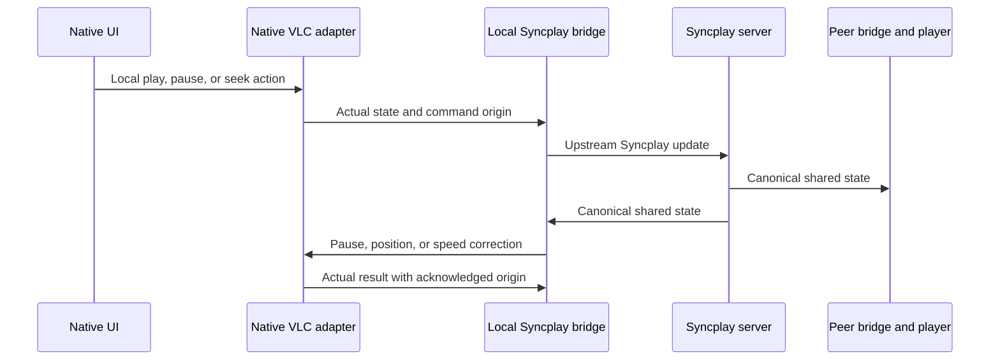

# Syncplay and room metadata

## Engine integration

Each device runs the pinned upstream `SyncplayClient` in a headless Python helper. The helper receives application-specific `BridgePlayer` and `BridgeUI` adapters, connects to a standard Syncplay server, and controls the native VLC adapter through local IPC.

The integration relies on a pinned internal Python API rather than a separately published stable SDK. Compatibility must be checked before every dependency update.

| Upstream entry point in `3rdparty/syncplay` | Integration |
|---|---|
| `syncplay/client.py:SyncplayClient.__init__(playerClass, ui, config)` | Inject the player and noninteractive UI adapters |
| `syncplay/players/basePlayer.py:BasePlayer` | Implement status requests, pause, position, speed, file opening, messages, startup, and cleanup |
| `SyncplayClient.updatePlayerStatus(paused, position)` | Report actual native playback state in seconds |
| `syncplay/protocols.py` | Reuse upstream transport, room, readiness, and playback-state behavior |
| `syncplay/ui/consoleUI.py` and `UiManager` in `client.py` | Identify the required noninteractive UI callbacks |

The helper does not launch the standard Syncplay UI or a separate VLC application. A custom BasePlayer adapter controls embedded libVLC directly. Drift correction remains in the upstream engine.

The headless helper needs complete upstream configuration, adapter callbacks, and a Python runtime without a GUI dependency. Python and its transitive sources are part of the helper's dependency graph.

The [engine source package](../syncplay-sources.md) preserves a reviewed subset of original engine and integration-reference files, reports imports/API/configuration candidates and probes pure upstream modules offline. Its `runtimeReady` flag is false. CPython/TLS closure, headless import/configuration and fail-closed transport behavior are prerequisites to initializing the client; source packaging does not enable the helper.

## Playback flow



The application selection coordinator owns the loaded movie/playlist item. The native helper disables Syncplay's stock shared-playlist controller with its normal configuration; it must not independently reopen or rewind that owned file. Selection metadata integration remains separate from playback timing.

A single command queue owns the native player. The coordinator applies local user actions and reports actual state to the engine. An engine correction must not become a second user command. Track origin, command ID, and media generation for ordering and acknowledgement while leaving drift decisions to Syncplay. Native `player.state` frames default to observation authority; only explicit user-origin frames enter the upstream user-change/send path. Correlated correction results update actual status with observation authority. Pending corrections suppress stale heartbeat playstate, while retaining the upstream ping/recovery flow.

The application boundary uses integer milliseconds; upstream Python APIs use floating-point seconds. Obtain positions from VLC. Use a monotonic clock for elapsed time rather than treating another device's wall-clock timestamps as the playback clock.

Only play, pause, seek, and movie/playlist-item selection are shared user playback actions. Volume/mute, tracks, subtitles, image/audio settings, previews, skip interval, window/cursor state, theme/language, and camera/microphone preferences are never replicated. Readiness and timing support the protocol; helper `setSpeed` performs local drift correction rather than synchronizing a user speed preference. Metadata bookkeeping does not authorize another remote stop, close, or settings action.

The [development helper](../syncplay-bridge.md) implements owned process startup, strict inherited-pipe validation and native transport boundaries. It remains separate from production provider activation and actual VLC acceptance.

## Local IPC v1

Use inherited anonymous pipes for `stdin` and `stdout` on both platforms. Frames are newline-delimited UTF-8 JSON. Standard output contains protocol frames only; standard error carries sanitized diagnostics. Serialize writes and read asynchronously away from the UI thread.

Example engine-to-player request:

```json
{"v":1,"id":"cmd-42","type":"player.setPosition","clientRunId":"run-7","mediaGeneration":3,"payload":{"positionMs":140500}}
```

Example acknowledgement:

```json
{"v":1,"replyTo":"cmd-42","type":"player.result","clientRunId":"run-7","mediaGeneration":3,"payload":{"status":"applied","positionMs":140500,"paused":true}}
```

| Message family | Responsibility |
|---|---|
| `bridge.hello / ready` | Negotiate IPC version, upstream revision, process run ID, and capabilities before accepting commands |
| `sync.connect / disconnect / setReady` | Manage Syncplay connection and readiness |
| `player.loaded` | Authorize an opaque local handle and its filename/duration/size metadata |
| `player.state` | Report actual time, pause, rate, duration, seekability, and loaded generation |
| `player.setPaused / setPosition / setSpeed / openFile` | Execute BridgePlayer actions in the native adapter |
| `sync.connection / participants / readiness` | Publish engine state to the application |
| `bridge.error / shutdown / stopped` | Report failures and coordinate shutdown |

`openFile` resolves an opaque local media handle through the coordinator. Remote descriptors cannot request arbitrary local paths. Network URL playback is outside the initial local-file feature set.

Limit a frame to 64 KiB including LF and bound all queues. Coalesce redundant position observations while retaining commands, acknowledgements, and failures. Use monotonically increasing command IDs and a bounded replay cache: return retained duplicate results without repeating a seek and reject older evicted IDs. Reject unsupported major versions, malformed frames, foreign process run IDs, and stale media generations. [Shared contracts](contracts.md) define the executable schemas, ordering, units, framing, and rejection cases. Exact runtime timeout values accompany the bridge implementation.

The application owns the helper. On EOF, the helper releases its engine and exits. After a bounded graceful shutdown, the parent may terminate only its own child. Use a Windows Job Object and an owned macOS process group with a signed embedded runtime. A helper crash pauses playback without closing the UI. A replacement helper receives a new run ID and current state; obsolete pending seeks are discarded.

## RoomMetadata service

Syncplay owns shared play/pause/seek and required protocol readiness/timing. Local rate corrections serve the engine; user speed preferences are not shared. A separate C# / ASP.NET Core service handles catalog exchange, media identity, watch-session selection, missing-file state, and the Meet URI over HTTPS/WSS. It does not implement a second playback controller or relay movie content.

The [room service](room-service.md) implements these endpoints and snapshot, pagination, command, and credential-management operations. Native clients are not yet connected:

| Endpoint | Responsibility |
|---|---|
| `POST /v1/rooms` | Create a room, owner credential, and binding to a Syncplay endpoint and room |
| `POST /v1/rooms/{id}/join` | Exchange an invitation for a scoped room token, snapshot, and member ID |
| `GET /v1/rooms/{id}/events` over WSS | Exchange catalog batches, membership bindings, selections, missing-media state, watch lifecycle metadata, and the Meet URI |
| `POST /v1/rooms/{id}/leave` | Revoke participation and clear ephemeral descriptors |

Each event includes a protocol version, server-issued room epoch and sequence number, member ID, and process run ID. Selection and watch start/end update a server-ordered watch generation. Reject obsolete epochs and generations. Reconnect uses a snapshot and resume cursor; missing events require a new snapshot. Client timestamps do not establish event order.

## Channel binding and lifecycle

A room snapshot defines the Syncplay endpoint, room name, and agreed client identity. Bind the metadata member ID to the username actually accepted by Syncplay after its handshake and to the process run ID. An entered display name or Meet identity alone is not a reliable cross-channel key.

Start flow: agree on media selection and generation, resolve authorized local handles, verify identity and duration, load paused, set Syncplay readiness, and permit upstream playback. A late participant receives the selection snapshot before applying the current playback position.

If metadata connectivity fails during playback, retain the agreed file and continue Syncplay. Operations requiring a new shared selection wait for recovery. Local End releases local resources and readiness without a fifth playback action. Watch-end metadata describes server bookkeeping and must not independently stop or close a peer player. If Syncplay fails, pause and become not-ready regardless of the other connections.

## Media identity

Use a normalized logical title ID to find candidates, then compare duration, file size, and available content digests. A title, duration, or resolution alone does not establish an identical edition. Cache full content hashes in the background, invalidating them after a size or modification-time change.

An identical full hash is a strong match. Different encodings or missing hashes require explicit edition confirmation. Ambiguous candidates never trigger automatic playback. Absolute paths remain local. Send catalog deltas in bounded batches over RoomMetadata rather than placing an entire library inside a helper IPC frame.

## Server compatibility

The integration targets the pinned Syncplay server and standard upstream clients. Connections use TLS without silent downgrade. A Syncplay server password is separate from application room authorization; invitations and RoomMetadata authorization remain independent. Application binaries contain no shared server credentials.

Standard Syncplay clients do not implement SyncWatch-specific catalog metadata.

See the [Syncplay protocol specification](https://syncplay.pl/about/protocol/). The pinned source defines the concrete engine behavior and integration points.

The [shared CPython startup profile](../python-startup.md) records exact original initialization/lifecycle declarations and proposed isolated package-path policy. Its CLI probe exercises the developer SDK only; native interpreter compilation, matching embedding ABI, actual package path behavior and complete runtime source/TLS closure remain required before initialization.

The shared first-party native startup module accepts explicit verified package paths and applies the generated isolated policy. Actual SDK fixtures exercise its C API and one-shot owner lifecycle on all three build platforms; this does not enable the pinned runtime. See [Python startup](../python-startup.md#native-helper-startup) for the API, development commands and remaining package/source/ABI gates.

The [native Python package verifier](../python-package.md) checks a trusted file inventory, rejects unexpected configuration and filesystem aliases, and produces owned paths for the startup API. Its completed scan is not an authenticated or immutable installation. Full pinned runtime/source/ABI and TLS/engine gates still apply before helper initialization.

The [bootstrap encoding package](../python-stdlib.md) provides a deterministic original-source ZIP and a native verification/startup fixture whose only module search path is that owned ZIP. It removes installed standard-library directories from that proof while retaining the explicit developer-SDK builtin/frozen boundary. A complete source-built native runtime, standard library and TLS/Syncplay graph are still required.

## Unicode type-table source and native proof

The [Unicode type-table component](../python-unicode.md) reproduces the pinned CPython Unicode 15.0 header from separately pinned data and executes an exhaustive native C transcript on all three targets. Its source/data payload and developer SDK proof do not enable an interpreter, embedding ABI or Syncplay runtime.

## SipHash source and native correspondence

The [SipHash component](../python-siphash.md) retains the separately pinned origin and original CPython modifications, validates original known answers and executes the selected raw functions on all three C SDK targets. Its provenance payload does not provide an interpreter, complete Python hashing or Syncplay runtime.

The [hashtable component](../python-hashtable.md) retains the separately pinned cfuhash provenance and verifies the original CPython hashtable with an independent dictionary corpus and allocation-failure injection on all three native C SDK targets. Its source/provenance package does not enable an interpreter, embedding ABI or Syncplay runtime.
