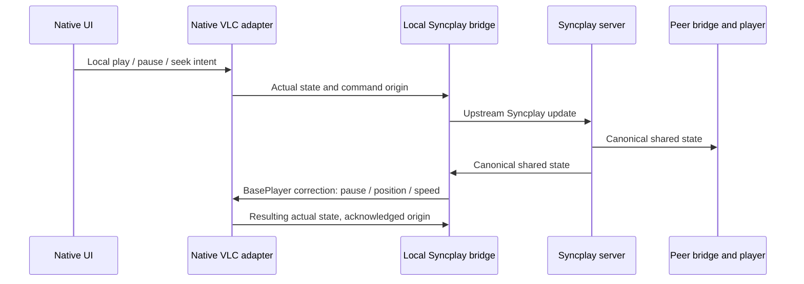

# Syncplay и данные комнаты

## Повторно используем engine

Вместо двух независимых реализаций Syncplay protocol в Swift и C# используем один upstream `SyncplayClient` из закреплённого submodule. На каждой машине свой headless Python helper. Он получает `BridgePlayer` и `BridgeUI` через существующий constructor injection, связывается со штатным Syncplay server и управляет нативным VLC adapter через локальный IPC.

Это наш адаптер к внутреннему Python API, а не официальный стабильный Syncplay SDK. Версия закреплена, совместимость проверяется перед каждым обновлением.

Проверенные точки расширения в `3rdparty/syncplay`:

| Upstream код | Использование |
|---|---|
| `syncplay/client.py:SyncplayClient.__init__(playerClass, ui, config)` | Ввод наших player/UI adapters |
| `syncplay/players/basePlayer.py:BasePlayer` | `askForStatus`, `setPaused`, `setPosition`, `setSpeed`, `openFile`, `displayMessage`, `drop`, `run` |
| `SyncplayClient.updatePlayerStatus(paused, position)` | Сообщить фактический native player state в секундах |
| `syncplay/protocols.py` | Upstream transport, rooms, readiness и playlist protocol |
| `syncplay/ui/consoleUI.py` и `UiManager` в `client.py` | Перечень callbacks для собственного noninteractive UI adapter |

Не запускать обычное окно Syncplay или отдельный VLC UI. Не использовать его VLC Lua adapter для встраиваемого libVLC: тот рассчитан на управление процессом плеера, а нам нужен свой BasePlayer bridge. Не переписывать upstream алгоритм коррекции drift.

Первый spike обязан проверить headless import, полный `config` из upstream defaults, callbacks и lifecycle без PySide/Qt. Установка `requirements_gui.txt` не требуется по замыслу, но отсутствие скрытого GUI import нужно подтвердить исполняемым тестом. Python и транзитивные runtime sources добавляются в `3rdparty/` до упаковки.

## Поток playback



Один playback command queue на native player. Local user intent применяется через coordinator; фактическое состояние сообщается engine. Engine correction не превращается во второй user seek. `origin`, `commandId`, `mediaGeneration` и acknowledgement используются для порядка и диагностики; tolerances и решение о коррекции остаются у Syncplay.

Время на границе приложения — целые миллисекунды. В upstream API — секунды с плавающей точкой. Положение берётся из VLC. Для elapsed durations используется monotonic clock; wall-clock timestamp другого устройства не служит часами фильма.

## Локальный IPC v1 — проект контракта

Два унаследованных anonymous pipes (`stdin/stdout`) на обеих ОС; протокол newline-delimited UTF-8 JSON. Только дочерний helper, без listening TCP port и file polling. stdout содержит только protocol frames, stderr — очищенную диагностику. Один writer сериализует frames; чтение неблокирующее и не на UI thread.

Пример запроса engine → native player:

```json
{"v":1,"id":"cmd-42","type":"player.setPosition","clientRunId":"run-7","mediaGeneration":3,"payload":{"positionMs":140500}}
```

Ответ native player → helper:

```json
{"v":1,"replyTo":"cmd-42","type":"player.result","clientRunId":"run-7","mediaGeneration":3,"payload":{"status":"applied","positionMs":140500,"paused":true}}
```

| Семейство | Назначение |
|---|---|
| `bridge.hello / ready` | Версия IPC, upstream commit, run ID, capabilities; до handshake команды запрещены |
| `sync.connect / disconnect / setReady` | Вход, выход, readiness; секреты не попадают в logs |
| `player.state` | Фактические time, pause, rate, duration, seekable и loaded media generation |
| `player.setPaused / setPosition / setSpeed / openFile` | Только команды BridgePlayer к native adapter |
| `sync.connection / participants / readiness` | Данные engine для UI/room binding |
| `bridge.error / shutdown / stopped` | Ошибки и согласованное завершение |

`openFile` принимает локальный opaque media handle, разрешаемый coordinator, а не путь с сервера. Связка Syncplay filename → handle строится из разрешённого каталога. URL playback в первой поставке не включается без отдельного решения.

Максимальный frame 64 KiB, ограниченные очереди и таймауты. Избыточные position observations можно объединять; user commands, acks и errors не теряются. Дубликат `commandId` возвращает сохранённый result, не выполняя seek повторно. Unknown major version, malformed frame, foreign run ID и stale generation отклоняются. До реализации формальная JSON schema и точные timeout values фиксируются в `contracts/` с tests.

Parent process — владелец helper. При EOF helper освобождает engine и заканчивает процесс; parent после ограниченного graceful shutdown завершает только собственный child. На Windows использовать Job Object для потомков, на macOS — собственную process group и подписанный embedded runtime. Crash helper ставит movie на паузу и не убивает UI. Новому helper нужны новый run ID и актуальный snapshot, старые pending seeks не воспроизводятся.

## Почему нужен RoomMetadata

В прототипе LiveKit передаёт весь каталог, `media_missing`, active watch session и start/end. Стандартный Syncplay синхронизирует состояние плееров и предоставляет rooms/readiness/playlist; контракт обмена полными библиотеками и app session metadata из прототипа туда автоматически не переносится.

Добавляем собственный сервис только метаданных на C# / ASP.NET Core с JSON по HTTPS/WSS. Syncplay продолжает быть единственным сетевым каналом play/pause/seek/rate/readiness. Не помещать второй playback controller в RoomMetadata, Google Meet chat или Co-Watching API.

Проект endpoints:

| Endpoint | Ответственность |
|---|---|
| `POST /v1/rooms` | Создать room, owner credential и binding к Syncplay endpoint/room |
| `POST /v1/rooms/{id}/join` | Обменять invitation на ограниченный room token, получить snapshot и member ID |
| `GET /v1/rooms/{id}/events` (WSS) | Catalog batches, membership binding, media selection, missing-media, watch start/end metadata, Meet URI |
| `POST /v1/rooms/{id}/leave` | Отозвать участие и очистить ephemeral descriptors |

Каждый event содержит `protocolVersion`, server-issued `roomEpoch`, `sequence`, `memberId`, `clientRunId`. Selection/start/end меняют `watchGeneration` в серверном порядке. Event с прежним epoch/run/generation отбрасывается. Snapshot + resume cursor обрабатывают reconnect; пропуск sequence требует нового snapshot. Сервис не использует timestamps клиента для установления порядка.

## Связывание каналов

Room snapshot фиксирует точные Syncplay endpoint, room name и согласованный client username. `memberId` связывается с фактически принятым Syncplay username после handshake, с run ID; совпадения введённых пользователями имён недостаточно. Идентификатор участника Meet не считается автоматически идентификатором Syncplay.

Start flow: согласовать media selection/generation → найти разрешённый local handle на обоих клиентах → проверить identity и duration → загрузить paused → установить Syncplay ready → разрешить upstream autoplay/play. При позднем входе сначала загрузить selection snapshot, затем принять Syncplay position; не стартовать неизвестный файл.

Если metadata channel потерян во время просмотра, сохраняется уже согласованный файл и работает Syncplay. Новые Start/switch/end metadata недоступны до восстановления; локальное End всегда освобождает ресурсы, а общий End отправляется после reconnect только если generation ещё актуальна. Если потерян Syncplay, pause и not-ready; доступность metadata/Meet не делает playback synchronized.

## Сопоставление файлов

Prototype movieId сохраняется для поиска кандидатов, но имя + duration/resolution не доказывают идентичность монтажа. Descriptors включают schema version, logical ID, duration, file size и доступный content digest; абсолютные пути не отправляются. Сильное совпадение — одинаковый полный content hash, вычисленный в фоне с локальным cache. Для разных encodes или отсутствующего hash — явное подтверждение подходящего кандидата и edition check, без автоматического выбора при коллизии. Проверка отменяется при изменении size/mtime.

Каталог передаётся delta/batches с revision; весь библиотечный список не попадает в один 64 KiB IPC frame. Library traffic идёт по RoomMetadata, а не через helper. Клиент не получает возможности открыть произвольный путь через remote descriptor.

## Сервер и совместимость

Для воспроизводимого теста — свой Syncplay server той же закреплённой версии; внешний публичный сервер можно использовать только отдельным compatibility test. TLS обязателен для реального подключения, downgrade не происходит молча. Upstream server password не следует считать полноценной app room authorization; приватные room invitations и авторизация RoomMetadata — отдельный механизм. Выбранное развертывание не должно раскрывать общие server credentials в клиентском binary.

Проверить: native Mac ↔ native Windows, native ↔ официальный Syncplay client/VLC для playback, разные сетевые задержки, pause/seek races, mismatched files, late join, server restart и bridge crash. Метаданные SyncWatch не обязаны поддерживаться стандартным клиентом; это отдельный уровень совместимости.

[Первичное описание Syncplay protocol](https://syncplay.pl/about/protocol/). Конкретные алгоритмы и extension points определяются закреплёнными исходниками, а не только этой страницей.
